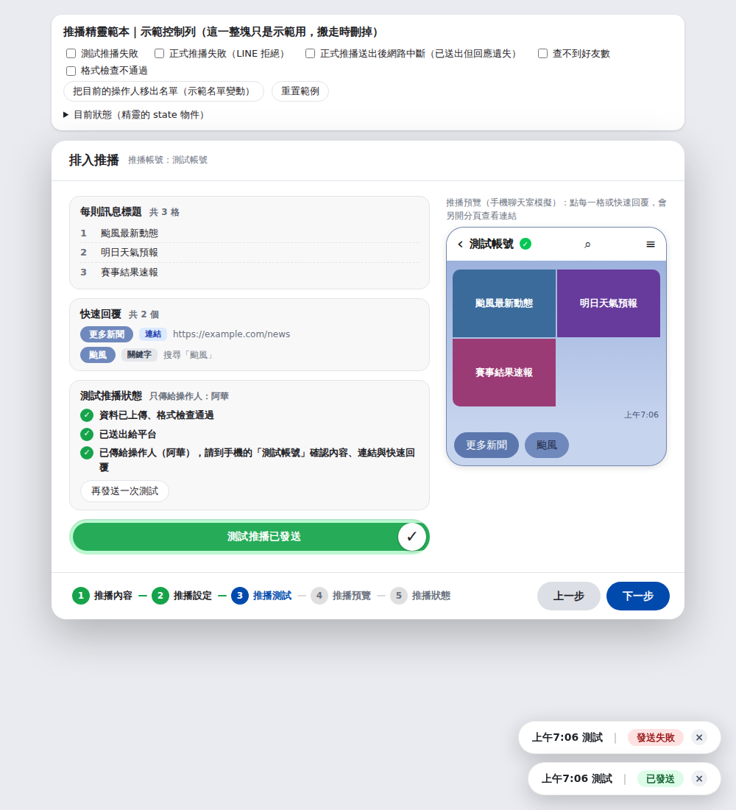

# 推播精靈（五步驟）設計規格

> 從「Line推播套版產生器」的「LINE原生推播」流程抽出來的設計。**一句話**：把「發出去就收不回」的操作，拆成五個一步一畫面的步驟，每一步都有明確的完成條件，最後用「先測試給自己 → 滑動才送 → 輸入人數確認 → 送出後鎖定」四道關卡，把誤發的機率壓到最低。

| 檔案 | 用途 |
|---|---|
| [`wizard-template.html`](wizard-template.html) | **可直接執行的範本**（單一檔案、零依賴、內建假後端，雙擊就能玩）。搬走時把它當骨架。 |
| `SPEC.md`（本檔） | 設計規格：流程、擋關／作廢規則、狀態模型、API 契約、元件規格、搬運步驟。 |
| [`shots/`](shots) | 各步驟截圖。 |
| `../../test/e2e/wizard-template.mjs` | 範本的自動化測試（47 項），搬走後可改寫成你專案的測試。 |



---

## 1. 設計原則（為什麼長這樣）

| # | 原則 | 具體做法 |
|---|---|---|
| 1 | **不可逆的操作要多道關卡** | 先測試推給操作人自己 → 測試通過才能預覽 → 滑動（不是點擊）才發測試 → 正式送出前要**親手輸入**好友數 → 送出成功就鎖定。 |
| 2 | **一步一畫面，進度列放最下面** | 步驟列與「上一步／下一步」同一排，在視窗最下方；內容區只放這一步的東西。 |
| 3 | **按鈕反灰時要說明原因** | 「下一步」沒完成時反灰，**游標移上去（或按一下）從上方彈出泡泡**：「第 N 步『名稱』還沒完成：缺什麼」。不讓使用者猜。 |
| 4 | **前一步的結論會被後一步推翻時，要主動作廢** | 換操作人、換帳號、改內容 → 測試結果與已上傳的資料作廢，退回對應步驟，並用訊息窗說明（見第 4 節）。 |
| 5 | **成功才鎖定，失敗不鎖定** | 失敗留在原畫面、顯示原因、可重試；成功後整個流程鎖死（連程式層也回不去），要改就是「新的一則」。 |
| 6 | **畫面完全由 state 決定** | 一個 `render()`，每次狀態變動都呼叫，冪等。不要在事件處理器裡手動東改一塊西改一塊。 |
| 7 | **前端擋是為了好用，後端擋才算數** | 所有安全規則（測試憑證、人數比對、1 位收件人、排程範圍）後端都要再檢查一次（第 7 節）。 |
| 8 | **「不確定有沒有成功」要老實講** | 網路中斷這類情況，不說「失敗」也不說「成功」，說「請先到推播列表確認」，並用同一把重試金鑰保證重按不會重複發送。 |

---

## 2. 流程總覽

```
 ┌────────┐ 內容完整 ┌────────┐ 操作人在名單內 ┌────────┐ 滑動測試成功 ┌────────┐ 輸入對人數 ┌──────────────┐
 │ 1 內容 │ ───────▶ │ 2 設定 │ ─排程時間合法─▶ │ 3 測試 │ ───────────▶ │ 4 預覽 │ ─確認推播─▶ │ 5 狀態（鎖定）│
 └────────┘          └────────┘                └────────┘              └────────┘            └──────────────┘
      ▲  ◀── 1～4 步任何時候都能點步驟列回頭 ──▶  ▲   換操作人／帳號 → 退回 3；內容有更動 → 退回 1；5 只能由「確認推播」成功進入
```

| 步驟 | 目的 | 畫面 | 完成條件（`stepDone`） | 「下一步」反灰時的泡泡 |
|---|---|---|---|---|
| **1 推播內容** | 編輯要發的內容 | 內容編輯器（範本：通知文字＋格子＋快速回覆） | `contentIssue()` 為空（沒有任何驗證錯誤） | 第一個錯誤＋「（另外還有 N 項）」 |
| **2 推播設定** | 誰操作、發到哪、何時發 | **操作人**（單選）、**推播帳號**（單選）、**推播方式**（立即／排程＋日期＋時間） | `setupIssue()` 為空：已選操作人、操作人在該帳號名單內、排程時間合法 | 「還沒選擇操作人」「名單裡找不到操作人…」「排程時間要在 5 分鐘之後」… |
| **3 推播測試** | 先推給自己確認 | 左：訊息標題清單、快速回覆、測試狀態、**滑動發送**；右：手機預覽 | `test === 'ok'` | 「請先滑動發送測試推播，先推給操作人自己確認內容」／傳送中「請稍候」 |
| **4 推播預覽** | 最後複查、截圖給主管 | 同第 3 步，上方多資訊框（帳號／方式／通知）；**截圖此畫面**；右下紅色「立即推播／排程推播」 | `go === 'ok'`（按鈕本身永遠可按，開確認視窗） | — |
| **5 推播狀態** | 看結果 | 狀態列＋「推播列表」「完成推播」 | — | — |

**進度列規則**（`render()` 內）：
- 圓圈：目前步驟＝藍色；已完成（含鎖定後的 1～4）＝綠色；其餘灰色。連接線跟著變綠。
- 可點：回頭永遠可以（1～4）；往前只能到「下一步」且目前這步已完成；**第 5 步永遠不能直接點**。
- 傳送中（`busy`）、鎖定（`go==='ok'`）：整條不能點。
- 第 5 步只能由 `fire()` 成功後進入；`goTo()` 在流程層擋掉，不只是按鈕反灰。

---

## 3. 擋關規則（Gate）

| 位置 | 擋什麼 | 實作 | 訊息（可直接沿用） |
|---|---|---|---|
| 1→2 | 內容驗證 | `validateContent()`，前後端同一份規則 | 「第 1 格的連結要是 http(s):// 開頭的完整網址。」 |
| 2→3 | 沒選操作人 | `setupIssue()` | 「還沒選擇操作人。」 |
| 2→3 | 操作人不在該帳號名單 | 名單用**名字**對應（見下） | 「『測試帳號』的名單裡找不到操作人『阿華』，請換人、換帳號，或先把他加進名單。」 |
| 2→3 | 名單還在讀／讀失敗 | `rosterFor(acct).loaded/error` | 「名單讀取中，請稍候。」 |
| 2→3 | 排程時間不合法 | `whenFor()`：5 分鐘後 ～ 14 天內，到分鐘，檢查「2/30」這類不存在的日期 | 「排程時間要在 5 分鐘之後」「最晚只能設在 14 天之內」 |
| 2 | 內容種類 vs 帳號 | `acctAllowed()`：內容只能發同種類的帳號（測試帳號例外），不符的帳號 pill 反灰 | tooltip「這份內容的種類不符」 |
| 3→4 | 沒有成功的測試 | `test === 'ok'` | 見上表 |
| 3 | 滑桿誤觸 | 要拖到最右（距終點 ≤ 2px）才觸發；中途放開彈回；內容有問題／沒操作人時鎖住 | — |
| 4 | 不知道好友數 | 向後端查；查不到就不給輸入 | 「查不到『…』的好友數，為了安全不能正式推播。」 |
| 4 | 沒輸入或輸入錯人數 | 輸入框**只提示格式不預填答案**（placeholder 是「輸入 18」，要使用者自己打一遍），`digits()` 容許千分位逗號；打對才顯示 ✓、紅色按鈕才亮 | ✓ / ✗ |
| 4 | 資料太舊 | 準備資料 > 28 分鐘 → 拒絕送出 | 「上傳的資料已超過 28 分鐘…請回到第 3 步重新推播測試一次」 |
| 4 | 內容在測試後被改 | `prep.sig !== contentSig()` | 「內容有更動，請回到第 3 步重新推播測試」 |

> **名單用名字對應**：同一個人在不同帳號（不同 Provider）的 ID 不同，所以「操作人」存名字，到各帳號名單用名字找 ID（`opTid(acct)`）。兩邊名單的名字必須一致，名單 UI 要擋同帳號內重名。

---

## 4. 作廢規則（Invalidation）

「前面做過的結論，因為後面改了東西而不再可信」——這是這個流程最容易出錯、也最重要的部分。

| 事件 | 作廢什麼 | 退回哪一步 | 備註（為什麼） |
|---|---|---|---|
| **換操作人** | 測試結果、測試憑證、**測試用**重試金鑰 | 若在第 4 步 → 退回 3 | 測試是推給「那一位」的，換人就不算數。**不清**正式重試金鑰（見 §6）。 |
| **換推播帳號** | 測試結果、測試憑證、**兩把**重試金鑰、好友數、確認輸入 | 同上 | 換帳號＝另一次發送。 |
| **內容有任何更動**（`contentSig` 變） | 準備資料、測試結果、確認輸入、結果…**整個流程**（帳號、方式、操作人保留） | 退回 1，訊息窗顯示原因 | 若上一則已完成鎖定：訊息改成「這是新的一則，請從第 1 步重新開始」。 |
| **名單變動**（操作人被移出該帳號） | 測試結果 | 若在第 4 步 → 退回 3 | `opRevalidate()`，名單重讀後自動比對。 |
| **傳送途中**換了操作人／帳號 | 這次回應的結果（**丟棄**） | 留在第 3 步 | 回應回來時比對 `op/acct/tid`，不符就說「傳送途中換了，這次不算數」。 |
| **傳送中**（`busy`） | — | — | 禁止換頁、換操作人、換帳號、改方式。 |
| **推播成功**（`go==='ok'`） | — | — | 全部鎖定；之後任何內容改動都視為新的一則。 |

---

## 5. 狀態模型

單一 `S` 物件（每個「版型／內容種類」各一份，範本只有一份）：

| 欄位 | 值 | 說明 |
|---|---|---|
| `step` | 1～5 | 目前步驟。`step>3 && !prep` 時強制退回 3。 |
| `prep` | `{prepareToken, sig, at}` \| `null` | 已上傳的準備資料。`sig` ＝ 上傳當下的內容簽章；`at` 用來判斷是否過舊。 |
| `acct` / `way` / `whenDate` / `whenTime` | — | 推播帳號、`'now'｜'sched'`、排程日期時間。 |
| `op` | 名字 | 操作人。存 `localStorage`（每台瀏覽器記住自己）。 |
| `test` | `''｜'busy'｜'ok'｜'bad'` | 測試推播狀態。 |
| `testToken` | 字串 | 後端簽發、**綁帳號**的測試通過憑證，正式推播必帶。 |
| `testMsg / testNote / testNames` | — | 測試狀態文字、收件人名單（顯示用）。 |
| `friends / friendsErr / friendsBusy` | — | 後端查到的好友數（確認視窗用）。 |
| `go` | `''｜'busy'｜'ok'｜'bad'` | 正式推播／排程狀態。`'ok'` ＝ 鎖定。 |
| `goErr / result` | — | 失敗原因、成功結果（`{kind:'now'｜'sched', at/when, friends, already}`）。 |
| `retryKey` | `{test, official}` | 兩把重試金鑰（UUID），見 §6。 |
| `win` | `{text, kind}` | 訊息窗（換頁就清掉）。`kind`: `''｜'ok'｜'bad'`。 |
| `confirmVal / shot` | — | 確認視窗輸入；截圖按鈕狀態（`busy｜copied｜saved｜bad`）。 |

名單另存 `roster[acct] = {loaded, loading, list, error}`；`opNames()` ＝ 所有帳號名單的名字聯集。

---

## 6. 安全與冪等設計

1. **重試金鑰（retryKey，UUID）**：每次「發送」帶一把；**同一次發送重送必須用同一把**（後端／平台據此去重），**不同的發送必須換新的**。
   - 測試推播：每次重測、失敗後重試、換帳號 → 換新金鑰。
   - 正式推播：只在換帳號時換；**換操作人不能清它**——否則「上次其實已受理、只是回應遺失」的群發，重按會再發一次。
   - 後端回「這把金鑰以前用過」（`alreadyAccepted`）：**測試推播不簽 `testToken`**（因為這次沒有真的發出去，不能算測試過）；正式推播則顯示「先前已受理，沒有重複發送」。
2. **測試憑證 `testToken`**：測試成功時由後端簽發，內含帳號、1 小時有效；正式推播／排程必帶，且帳號要對得上。
3. **確認人數**：前端要求使用者自己輸入；後端再比對（範本：差距在 `max(50, 2%)` 以內，好友數 ≤ 50 的小帳號只容許差 1）。查不到好友數就不發。
4. **準備資料時效**：後端保留 30 分鐘；前端 > 20 分鐘時，按「測試」會自動重傳；> 28 分鐘一律不准正式推播。
5. **成功之後只做不會出錯的事**：`fire()` 在 `await` 成功後，只做指派 state 與關視窗，不再呼叫任何可能丟例外的東西——避免「其實已送出卻顯示失敗」讓人重按。
6. **網路中斷（`TypeError`／`AbortError`）**：視為「不確定」，泡泡寫「出現錯誤，請先到推播列表確認，再重新推播流程」，錯誤框說明「同一次發送重按不會重複發送」。
7. **預覽連結只開 `http(s)`**：`okUrl()` 擋掉 `javascript:` 等；一律 `target=_blank rel="noopener noreferrer"`。
8. **所有 DOM 都用 `textContent` 組**（`el()`），不用 `innerHTML` 拼使用者內容。

---

## 7. 後端 API 契約

精靈只透過 6 個函式與後端溝通（範本的 `Api`）。你的後端只要提供同樣語意即可。

| 函式 | 請求 | 回應 | 後端必須強制的規則 |
|---|---|---|---|
| `roster(channel)` | 帳號 | `{testers:[{tid,name}]}` | — |
| `prepare(content)` | 完整內容（圖片、連結、通知文字…） | `{prepareToken}` | 再驗一次內容；暫存 30 分鐘；**不發送**。 |
| `validate({prepareToken, channel})` | — | `{valid, message?}` | 向平台做格式檢查（dry-run），**不發送**。 |
| `friends(channel)` | 帳號 | `{followers: number｜null}` | 唯讀；查不到回 `null`（前端據此擋下）。 |
| `send({prepareToken, channel, retryKey, mode?, testers?, confirmTotal?, testToken?})` | `mode:'test'`＋`testers:[id]`＝測試；沒有 `mode`＝正式群發 | 測試：`{testToken, recipients, friends}`；正式：`{sentAt, friends, alreadyAccepted, requestId}` | 見下 |
| `scheduleCreate({…, runAt, retryKey})` | 同正式，加 `runAt`（ISO 8601 含時區） | `{schedule:{id, runAt}}` | 同正式；時間 5 分鐘後 ～ 14 天內；用 `retryKey` 去重（回應遺失後重按不多排一筆）。 |

**`send` 的後端規則**（前端一律只當提示）：
- 測試：`testers` **剛好 1 位**、必須在該帳號名單內；金鑰重複 → 回 `alreadyAccepted:true` 且**不給 `testToken`**。
- 正式：必須帶**同帳號**、**未過期**的 `testToken`；`confirmTotal` 與後端查到的好友數比對；內容種類要對得上帳號；金鑰重複 → 回 `alreadyAccepted:true`（不重發）。
- 排程到點發送時，後端要**重新**檢查好友數（原專案：與建立時差距 ≤ 10%）、額度，並用建立時的 `retryKey`；暫時性錯誤（5xx／429／網路）重試，超過預定時間太久（原專案：30 分鐘）就放棄，避免新聞過時才發。

### 原專案（LINE Messaging API）的對照

| 範本 `Api` | 原專案 Worker 端點 | LINE API |
|---|---|---|
| `roster` | `POST /line/testers/list` | — （名單存 R2） |
| `prepare` | `POST /line/prepare` | — （圖片存 R2，內容封存 30 分鐘） |
| `validate` | `POST /line/validate` | `validate/broadcast` |
| `friends` | `POST /line/status` | `insight/followers` |
| `send(mode:'test')` | `POST /line/send` | `multicast`（只 1 位）＋ `X-Line-Retry-Key` |
| `send()` 正式 | `POST /line/send` | `broadcast` ＋ `X-Line-Retry-Key`；先查額度 |
| `scheduleCreate` | `POST /line/schedule/create` | LINE 本身沒有排程 → Worker Cron 每分鐘掃描，到點才 `broadcast` |

---

## 8. UI 元件規格

### Design token

| Token | 淺色 | 深色 | 用途 |
|---|---|---|---|
| `--accent` | `#004aad` | `#3d7fe0` | 目前步驟、主要按鈕、旋鈕 |
| `--success` | `#16a34a` | `#4ade80` | 已完成步驟、✓ |
| `--danger` | `#dc2626` | 同左 | 第 4 步「立即推播」、確認按鈕、錯誤 |
| `--track` / `--knob` | `#dcdfe5` / `#fff` | `#2b2f38` / `#4a505c` | 膠囊凹槽／凸起的圓鈕（滑桿、分段控制） |
| `--card` / `--bg` / `--border` / `--text` / `--muted` | 見範本 | 見範本 | 一般 |
| `--ctl-h` / `--inset` | 48px / 5px | — | 滑桿與分段控制的高度、內縮 |

視窗寬 860px、圓角 20px；膠囊按鈕一律 `border-radius: 99px`；字級 13～14px 為主。

### 元件

| 元件 | 規格 |
|---|---|
| **步驟列** | 圓圈 24px＋名稱 13px/700；連接線 12×2px；位於視窗底部左側。右側 `上一步（灰）／推播列表／下一步（藍）`；第 4 步「下一步」變**紅色**「立即推播／排程推播」；第 5 步變「完成推播」。 |
| **「下一步」反灰＋泡泡** | 用 `is-disabled` class ＋ `aria-disabled`（**不用 `disabled`**，否則收不到 hover／click）；泡泡是 `::after { content: attr(data-tip) }`，黑底白字、圓角 16px、貼按鈕上方 12px；`:hover`、`:focus-visible`、按一下（加 `.tip` 2.6 秒）都會顯示。 |
| **訊息窗** | 黏在內容最上方（`position: sticky`），三種色：預設灰、`ok` 綠、`bad` 黃；換頁清空。 |
| **選項 pill** | 操作人、帳號：圓角膠囊，選中＝淺藍底藍字；操作人 pill 右側小字標示「這個人在哪些帳號的名單裡」；不可選＝半透明。 |
| **分段控制（立即／排程）** | 灰色凹槽＋藍色旋鈕，**選中那段變透明，旋鈕滑過去**（0.3s）；排程那段內含日期／時間兩個選擇器（點了自動切到排程）。 |
| **滑動發送** | 高 48px；白色圓鈕拖到最右才觸發（綠色填色跟著長）；中途放開 0.25s 彈回；文字有流光動畫；成功後整條變淺綠、圓鈕停在右側打勾；**鍵盤**：焦點在圓鈕上，→ 每按一次前進 1/5，到底觸發。`role="slider"` ＋ `aria-valuenow`。 |
| **狀態列** | 圓點 18px：`ok`（綠 ✓）、`busy`（黃 …）、`bad`（紅 !）、`wait`（灰 ·）。 |
| **確認推播視窗** | 蓋住整個畫面；寬 440px；上方帳號／方式；**黃色警告框**（「推播送出後無法收回。」；排程版改成「排程時間到就會自動推播。要取消請到…」；測試帳號再加一行）；「確認人數」輸入框＋✓／✗ 圓標；紅色「確認推播」輸入對才亮；送出中不能關、不能取消；Esc／點外面可關（送出中除外）；錯誤顯示在框內紅底。 |
| **手機預覽** | 寬 300px，圓角 24px；頂列（帳號名＋認證章）、訊息本體、快速回覆橫向捲動；**每一格、每顆快速回覆都能點**（另開分頁，不影響精靈）；沒連結的格子半透明不可點。 |
| **截圖此畫面** | 把複查資訊（帳號、方式、通知、全部標題、快速回覆、操作人與時間）畫成 760px 寬 PNG（×2 解析度），`navigator.clipboard.write` 複製；不支援就改下載。按鈕四態：製作中／✓已複製（綠）／✓已下載／✗失敗（紅）。 |
| **右下角泡泡** | 「訊息名稱｜狀態」；狀態：推播中（黃）、已發送（綠，8 秒後自動消失）、發送失敗／未知（紅，要手動關）、已排程（藍）；同一次發送重按會更新**同一個**泡泡（用 `fireKey` 當 key）；蓋在所有視窗之上，泡泡本身不擋滑鼠、只有 × 可點。 |

---

## 9. 搬運指南

### 要保留、要替換、要刪

| 類別 | 內容 |
|---|---|
| ✅ **保留（流程骨架）** | `S`／`newState`、`stepDone/stepWhy/goTo`、`testDrop/testInvalidate/opRevalidate/opSet/acctSet/resetFlow/onContentChanged`、`prepare/sendOut/testRun/fetchFriends/cfm*/fire`、`render()` 的步驟列與按鈕邏輯、滑桿、泡泡、全部 CSS 的步驟列／滑桿／確認視窗／泡泡 |
| 🔁 **替換** | `CONFIG`（步驟名、帳號、排程限制）；`Api`（換成真的 `fetch`）；`defaultContent / validateContent / contentSig`（你的資料模型）；第 1 步編輯器（`#wzP1`、`editorBuild`）；第 3～5 步右側預覽（`renderChat`）；截圖內容（`shotBlob`）；文案 |
| 🗑 **刪除** | 整個 `Mock`、`<div class="demo-bar">`、`Demo` 相關事件（`flagBind`、`dfDropOp`、`dfReset`）、`Api` 裡的 `Mock.flags` 判斷 |

### 步驟

1. 先開 `wizard-template.html` 玩一遍（試試測試失敗、網路中斷、操作人移出名單這幾個開關）。
2. 複製檔案，改 `CONFIG`。
3. 把你的內容模型接進 `content`／`validateContent`／`contentSig`；**`contentSig` 一定要涵蓋所有「會影響發出去內容」的欄位**——它是作廢機制的唯一依據。
4. 實作 `Api` 六個函式；先讓假後端的規則（§7）在你的真後端也成立。
5. 把「推播列表」「完成推播」接到你的畫面（範本是 `alert`／重置）。
6. 改寫 `test/e2e/wizard-template.mjs` 當你專案的回歸測試。

### 搬到框架（React／Vue）時

- `S` 對應 component state（或 store）；`render()` 對應「由 state 產生 UI」——範本刻意寫成冪等，所以不用逐一翻譯事件。
- 作廢規則（§4）與擋關（§3）放在 state 的 reducer／action 內，不要散落在元件裡。
- 滑桿用 pointer events，不要用 `drag`（觸控裝置不支援）。

### 範本函式 ↔ 原專案（`index.html`）函式

| 範本 | 原專案 | | 範本 | 原專案 |
|---|---|---|---|---|
| `render` | `lineUpdateSteps` | | `testRun` | `lineTestRun` |
| `stepDone / stepWhy` | `lineStepDone / lineStepWhy` | | `fire` | `lineFire` |
| `goTo` | `lineGoTo` | | `cfmOpen / cfmRender / cfmClose` | `lineCfmOpen / lineCfmRender / lineCfmClose` |
| `testDrop / testInvalidate` | `lineTestDrop / lineTestInvalidate` | | `prepare / sendOut` | `linePrepare / lineSend` |
| `opRevalidate / opSet / acctSet` | `lineOpRevalidate / lineOpSet / lineAcctSet` | | `fetchFriends` | `lineFetchFriends` |
| `resetFlow / onContentChanged` | `lineResetFlow / lineInvalidateIfChanged` | | `shotBlob / shotRun` | `lineShotBlob` 等 |
| `whenFor / whenSet` | `lineWhenFor / lineSetWhen` | | `bubble` | `pushBubble` |

---

## 10. 踩過的坑（設計決策的理由）

| 坑 | 決定 |
|---|---|
| 反灰按鈕用 `disabled` 就收不到 hover，沒辦法解釋原因 | 改用 `is-disabled`＋`aria-disabled`，在 click 裡自己擋。 |
| 只靠「按鈕反灰」擋流程，用程式或快速連點可以繞過 | 擋關寫在 `goTo()`／`fire()`／`cfmOpen()` 這些**流程函式**裡，按鈕狀態只是外觀。 |
| 換操作人時連正式重試金鑰一起清掉 | 上次已受理但回應遺失的群發，重按會**再發一次**。所以只清測試金鑰。 |
| 測試推播傳送途中使用者換了操作人 | 回應回來要比對，不符就丟棄；否則會把「對另一個人的測試」當成這個人測試過。 |
| 後端回「金鑰以前用過」卻當成測試成功 | 這次**沒有真的發出去**，不能算測試過，也不簽憑證，要換新金鑰重測。 |
| 輸入確認人數時把答案預填或提示太明顯 | placeholder 只寫「輸入 N」，要使用者自己打；打錯顯示 ✗，紅色按鈕不亮。 |
| 成功後還去更新別的東西，那一步丟例外 → 畫面顯示失敗 → 使用者重按 | 成功後只做不會出錯的事（§6-5）。 |
| 預覽連結用 `href` 直接放使用者輸入 | 只放 `http(s)`，且 `noopener noreferrer`。 |
| 不同帳號同一個人 ID 不同 | 操作人用名字對應，名單 UI 擋重名。 |
| 內容在測試後被改，沒人發現 | 內容簽章（`contentSig`）比對，任何更動就整個流程作廢並說明。 |

---

## 11. 範本沒有做、但原專案有的

| 項目 | 說明 |
|---|---|
| 圖片產生與上傳 | 原專案第 1 步是完整的畫布編輯器，第 3 步才上傳圖片（不另設「傳送資料」按鈕）。 |
| 額度核對 | 測試推播後，向平台查實際用量與預估核對（`lineVerifyUsage`）。 |
| 推播列表 | 每筆推播的狀態、點擊統計、取消排程；排程時間一到前端先顯示「推播中」。 |
| 權限管理 | 名單的新增／編輯／移除、管理者登入（見主專案 README）。 |
| 每個版型各一份進度 | 原專案新聞／娛樂版型各有獨立的 `S`；範本只有一份。 |
| 手機預覽畫入截圖 | 範本的截圖只含文字資訊。 |

---

## 12. 給 AI 的移植提示詞

把這段連同 `wizard-template.html`、本檔一起貼給 AI：

```
請把「推播精靈範本」移植到我的專案。
- 骨架（步驟列、擋關、作廢、確認人數、滑動測試、鎖定、重試金鑰）照 wizard-template.html，不要改動行為；規則以 SPEC.md 第 3、4、6 節為準。
- 我的內容模型是：<描述你的資料欄位>；請改寫 defaultContent / validateContent / contentSig，contentSig 必須涵蓋所有會影響發送內容的欄位。
- 後端是：<描述你的 API>；請實作 Api 六個函式，並確保 SPEC.md 第 7 節「後端必須強制的規則」在後端也成立。
- 刪掉 Mock 與 demo-bar；把「推播列表」「完成推播」接到 <你的畫面>。
- 技術棧：<原生／React／Vue…>。若用框架，把 render() 改成由 state 產生 UI，並把作廢與擋關規則放在 state 邏輯裡。
- 最後依 test/e2e/wizard-template.mjs 的檢查項目，寫出對應的測試。
```
